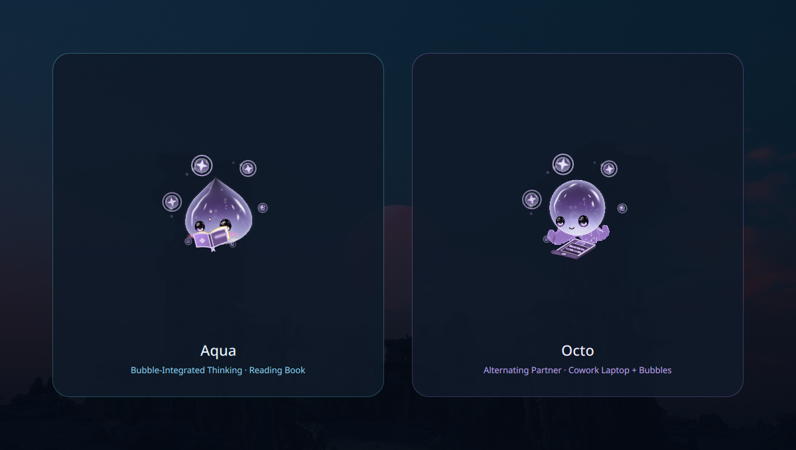
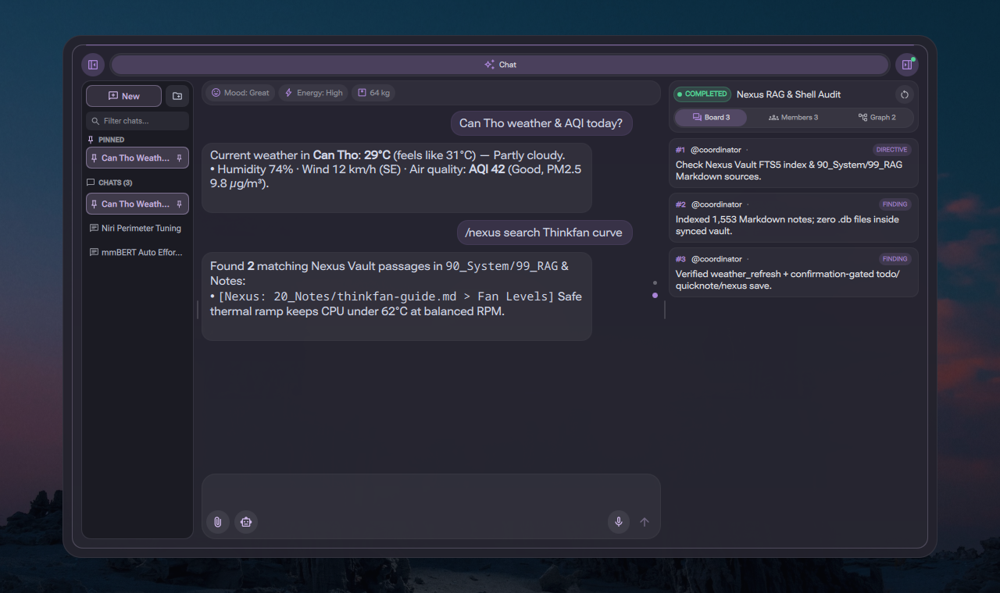

# Alis-Companion

Ambient liquid companions (**Aqua** and **Octo**) and a local-first AI assistant for the [**Alis**](https://github.com/llocphann/Alis) Wayland desktop shell.

<p align="center">
  
</p>

## Highlights

- **Expressive Dual Cast (Aqua & Octo)** — Switch between **Aqua** and **Octo** with smooth skeletal & shader-driven expressions, perimeter edge attachment, reading-book & cowork-laptop animations, and **Bubble-Integrated Thinking** (slow liquid bubbles while idle that transform into a luminous harmonic orbit while thinking).
- **Floating Chat & Edgebar Pocket** — Summon `AquaTalkCloud` on demand to pin conversations, filter threads, stage files in the inline Left Edgebar **Pocket**, and click **Mood**, **Energy**, and **Weight** chips synchronized with your Nexus Journal check-ins.
- **Standalone `/swarm` Multi-Agent Workspace** — Trigger `/swarm` right from the Chatbox composer or toggle the collapsible Right Sidebar (`Board` | `Members` | `Graph`) to follow coordinated sub-tasks visually without leaving your chat flow.
- **Local Tools & Unified Nexus Vault RAG** — Query local desktop state (including Alis weather updates and system context) under strict local-only defaults, and index Markdown knowledge notes in your Nexus Vault (`90_System/99_RAG/`) backed by an external SQLite FTS5 store (`nexus_rag.db`) that avoids vault sync conflicts.
- **Voice & Adaptive Reasoning** — Speak directly with sound-reactive waveform feedback, optional icon-filtered TTS replies, and **Auto Thinking Effort** routing calibrated to prompt complexity.

<p align="center">
  
</p>

## Installation

Install `Alis-Companion` into your user data directory alongside **Alis** (`hostApi: 1`) from a clean git checkout:

```sh
python3 scripts/install.py install
```

To remove the installed companion bundle cleanly without removing Alis core:

```sh
python3 scripts/install.py uninstall
```

Settings for **Companion** and **AI** appear inside **Alis Settings → Abyss & Bar**.

## Documentation & Links

- [Documentation Index](docs/README.md) — runtime boundaries, Unified Nexus RAG storage layout, and dormant context protocol reference
- [Alis-Companion GitHub Issues](https://github.com/llocphann/Alis-Companion/issues) — active bug reports and feature tracking
- [Alis Core Shell](https://github.com/llocphann/Alis) — Wayland host shell (`dev` / `stable`)

---

- **License:** GPL-3.0-or-later; imported source attribution is retained.
- **Release Schedule:** Maintained alongside Alis `1.0.0` with updates released on a **quarterly, semi-annual, or annual** cadence.
